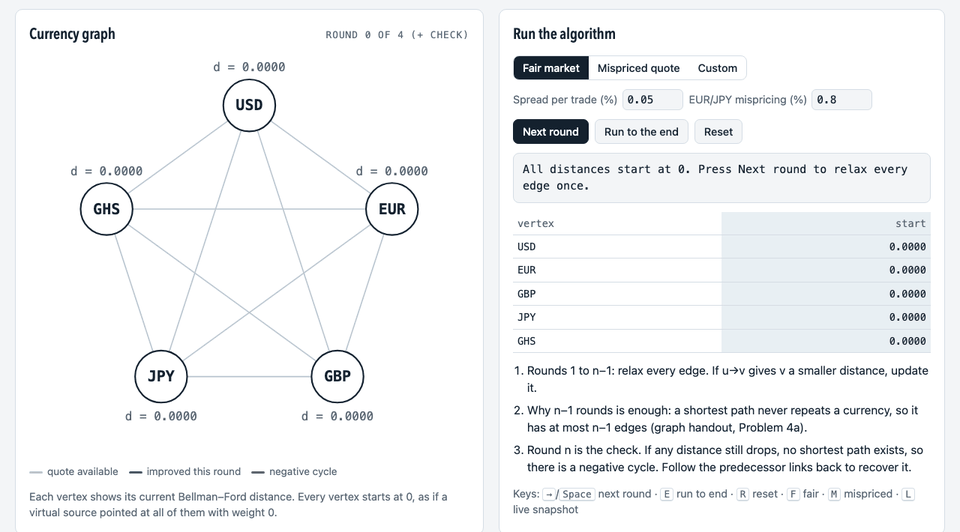

# fx-arbitrage-graph

[](https://github.com/emmanueladutwum123/fx-arbitrage-graph/actions/workflows/ci.yml)
[](https://emmanueladutwum123.github.io/fx-arbitrage-graph/)
[](https://emmanueladutwum123.github.io/fx-arbitrage-graph/slides/)

Can you make money just by exchanging currencies in a circle? This project turns that
question into graph theory and answers it on real exchange data.

* **Assets are vertices.** A quote "1 unit of *u* buys *r* units of *v*" is a directed edge
  *u → v*.
* **Weight each edge by −log r.** Then a round trip is profitable,
  r₁·r₂·…·r<sub>k</sub> > 1, exactly when its weights add up to less than zero. **Arbitrage is a
  negative-weight cycle.**
* **Bellman–Ford finds negative cycles.** Start it from a virtual source (distance 0 to every
  vertex) and relax all edges n − 1 times. A shortest path never repeats a vertex, so it has at
  most n − 1 edges. If round n still improves a distance, there is a negative cycle, and
  walking the predecessor pointers back recovers the trade. O(V·E).

Every step is proved in [`docs/theory.md`](docs/theory.md).

A 75-second captioned walkthrough of the demo (fair market, mispriced quote, real snapshot) is at
[`docs/video/demo-walkthrough.mp4`](docs/video/demo-walkthrough.mp4), also served at
[/video/demo-walkthrough.mp4](https://emmanueladutwum123.github.io/fx-arbitrage-graph/video/demo-walkthrough.mp4).
It is built from real renders of the page by `scripts/make_demo_video.py`.



## What's here

| | |
|---|---|
| `src/fxarb/` | Python package: quote graph, Bellman–Ford, SPFA, brute-force checker, profit and size of a cycle, data sources, CLI |
| `docs/theory.md` | The math: log transform, proof that n − 1 rounds suffice, correctness of the round-n check, why the predecessor walk lands on the cycle, complexity, SPFA, why not Dijkstra |
| `web/` | Interactive demo, deployed to [GitHub Pages](https://emmanueladutwum123.github.io/fx-arbitrage-graph/). Step-through teaching mode that auto-plays in a loop until you click or press a key, plus a live-snapshot mode on recorded Kraken and Binance.US order books. Static and offline: no network calls, works from `file://` |
| `slides/` | 20-minute talk for Math 280 (reveal.js + KaTeX, bundled for offline use), [live](https://emmanueladutwum123.github.io/fx-arbitrage-graph/slides/), [PDF](slides/fx-arbitrage-slides.pdf) |
| `results/` | Measured benchmarks and the analysis of a real 2-hour recording (1,440 snapshots) |
| `cpp/` | Optional C++20 port (pybind11), cross-checked against the Python code |

## Install and use

```bash
git clone https://github.com/emmanueladutwum123/fx-arbitrage-graph
cd fx-arbitrage-graph
python -m venv .venv && source .venv/bin/activate
pip install -e ".[dev]"          # add ,parquet for Parquet recordings
```

```bash
fxarb demo                                   # the 5-currency example, round by round
fxarb demo --bump 0                          # fair market: stops early, no cycle

fxarb scan --venue frankfurter               # ECB reference rates (no arbitrage, by design)
fxarb scan --venue kraken                    # live Kraken top of book, 0.80% taker fee
fxarb scan --venue all --fee 0               # Kraken + Binance.US, ignoring fees
fxarb scan --venue all --save-json web/data/snapshot.json   # refresh the demo's snapshot

fxarb record --venue kraken binanceus --interval 5 --duration 7200 \
             --out recordings/run.csv.gz     # .csv, .csv.gz or .parquet
fxarb analyze recordings/run.csv.gz --fee 0.001 --json-out results/run.json
```

`scan` and `analyze` use public REST endpoints only (no API keys). Fees are stored nowhere in a
recording; `analyze` applies them afterwards, so one recording can be studied at several fee
levels. Default fees are each exchange's entry-tier **taker** fee, checked on 2026-11-21 on the
exchanges' own pages: Kraken Pro Tier 1 is 0.40% maker / **0.80%** taker
([kraken.com/pro/fees](https://www.kraken.com/pro/fees)); Binance.US is 0% maker / **0.02%** taker
([binance.us/en/fee](https://www.binance.us/en/fee)). Fees change, so pass `--fee` to override.

To serve the demo locally: `python -m http.server -d web` (or just open `web/index.html`).

## How the data is turned into a graph

For a pair BASE/QUOTE with best bid *b*, best ask *a*, depth at those prices, and fee *f*:

* sell BASE at the bid: edge BASE → QUOTE, rate *b*(1 − *f*), capacity = bid size (in BASE);
* buy BASE at the ask: edge QUOTE → BASE, rate (1 − *f*)/*a*, capacity = ask size × *a* (in QUOTE).

When several venues quote the same direction, only the best rate is kept (a worse parallel edge
can never be part of a better cycle). The **maximum tradable size** of a cycle is set by its
tightest leg: starting with *x* units, the amount reaching leg *i* is *x*·r₁⋯r<sub>i−1</sub>, which
must not exceed that leg's capacity.

**Same ticker, different token.** Combining venues exposed symbols whose prices differ by 1.7× to
100× between Kraken and Binance.US (for example `ONE`, `ENJ`): either different tokens under one
ticker, or a token whose deposits are halted on one side. Treating them as one asset produced fake
"+10,000%" cycles. When a symbol's USD value differs by more than 10% between venues, the scanner
keeps the venues apart (`ENJ@kraken`, `ENJ@binanceus`).

## Results on real data

**ECB reference rates** (`fxarb scan --venue frankfurter`, 30 currencies, 870 edges): no
negative cycle; the search settles after 2 rounds. This is expected, since the ECB publishes
mutually consistent reference rates, not tradable quotes.

**Crypto order books.** `fxarb record` saved the best bid and ask, with sizes, for every pair on
Kraken and Binance.US every 5 seconds: **1,440 snapshots** (median 681 assets, 1,618 pairs) between
02:10 and 04:56 UTC on 22 November 2026. The laptop slept once, leaving a 46-minute hole plus a few
short fetch failures (`recording_gaps` in the JSON). The analysis covers **1 h 59 m**, and a cycle
is never counted as persisting across a gap. Full output:
[`results/2026-11-21_kraken_binanceus.json`](results/2026-11-21_kraken_binanceus.json), produced by

```bash
fxarb analyze recordings/2026-11-21_kraken_binanceus.csv.gz --fee 0.001 --json-out results/2026-11-21_kraken_binanceus.json
```

| venue | fees per trade | snapshots with ≥1 cycle | median net return | median max profit | largest max profit |
|---|---|---:|---:|---:|---:|
| Kraken | none | 1,440 (100%) | +0.045% | $0.04 | $61.04 |
| Kraken | 0.10% (hypothetical) | 518 (36.0%) | +0.161% | $0.0002 | $0.67 |
| Kraken | **0.80% taker** | **0 (0%)** | | | |
| Binance.US | none | 1,433 (99.5%) | +0.003% | $0.002 | $0.56 |
| Binance.US | **0.02% taker** | **95 (6.6%)** | +0.033% | $0.0004 | $0.0015 |
| Binance.US | 0.10% (hypothetical) | 0 (0%) | | | |
| both | none | 1,440 (100%) | +0.070% | $0.04 | $29.73 |
| both | **taker** | **198 (13.8%)** | +0.345% | $0.0013 | $0.048 |
| both | 0.10% (hypothetical) | 920 (63.9%) | +0.119% | $0.007 | $0.67 |

"Max profit" is the net return times the largest size the best price level allows (the tightest
leg); medians are over all cycle observations. The largest single one was a 5-leg Kraken cycle,
EUR → BTC → GBP → USDC → USDT → EUR: +0.108% on up to $56,560. What this says:

* **Without fees, negative cycles are everywhere**, in every snapshot, but they are small: the
  median one would earn about 4 cents. Single returns reach +2.06% on Kraken, but the tradable
  size is what limits profit: the median cycle there allows only $198.
* **At the real entry-tier fees, Kraken has none at all** in 2 hours. On Binance.US, whose taker fee
  is only 0.02%, a few survive in 6.6% of snapshots, each worth at most $0.0015.
* **Combining venues adds a few cross-venue cycles.** The best is about 5 cents on $13: buy the
  thinly traded token USDUC on Kraken, sell it on Binance.US. It would also require money already
  sitting on both exchanges. A median of 25 symbols per snapshot were kept apart because the two
  venues price them more than 10% differently.
* **They don't last.** With no fees, the median cycle is seen in a single 5-second snapshot. With
  taker fees on both venues, the median episode is 4 snapshots (15 s), the longest 190 s.
* The hypothetical 0.10% fee rows show how quickly the picture changes for a large trader with
  lower fees, but the sizes stay small (median under $10).

With no fees, `analyze` hit its limit of 20 distinct cycles per snapshot in most snapshots, so the
distinct-cycle counts in the JSON are lower bounds for those rows. Bellman–Ford finds *a* negative
cycle, not the best one (see Limitations), so the profit figures describe the cycles it listed.

## Performance

Pure Python, single thread, measured on an Apple M2 (8 cores, 8 GiB), macOS, CPython 3.12. Full
table with edge-scan counts: [`results/benchmarks.md`](results/benchmarks.md).

| graph | V | E | cycle? | Bellman–Ford | BF + pred check | SPFA | C++ BF + check |
|---|---:|---:|:---:|---:|---:|---:|---:|
| real kraken, taker fees | 632 | 2,706 | no | 0.30 ms (3 rounds) | 0.39 ms | 0.61 ms | 0.012 ms |
| real kraken, no fees | 632 | 2,706 | yes | 70.58 ms (632 rounds) | 0.13 ms | 0.77 ms | 0.006 ms |
| real binanceus+kraken, taker fees | 704 | 3,086 | no | 0.44 ms (4 rounds) | 0.60 ms | 0.73 ms | 0.015 ms |
| real binanceus+kraken, no fees | 704 | 3,086 | yes | 93.41 ms (704 rounds) | 0.15 ms | 0.87 ms | 0.006 ms |
| synthetic n=3000, deg 8, consistent | 3,000 | 24,000 | no | 5.01 ms (5 rounds) | 5.99 ms | 9.80 ms | 0.255 ms |
| synthetic n=3000, deg 8, 1% mispricing | 3,000 | 24,000 | yes | 3321.10 ms (3000 rounds) | 2.71 ms | 4.81 ms | 0.172 ms |
| adversarial chain n=800 (reverse order) | 800 | 799 | no | 25.68 ms (800 rounds) | 47.13 ms | 57.60 ms | 1.543 ms |

What the numbers say:

* **With no cycle (the normal case after fees), early exit makes Bellman–Ford fast**: real
  graphs of 200–700 assets settle in 2–4 rounds, under a millisecond. Plain Bellman–Ford is
  slightly faster than SPFA here, most likely because its inner loop does less bookkeeping.
* **With a cycle, classic Bellman–Ford must run all n rounds** before the round-n check fires:
  3.3 s for 3,000 assets. The fix is the predecessor-graph check (any cycle of predecessor
  pointers is negative, Lemma 4 in the theory notes): it finds a cycle after 1–2 rounds, 540× to
  1,200× sooner on these graphs. This check, not SPFA's queue, is where SPFA's speed on these graphs comes
  from; in pure Python, Bellman–Ford with the check beats SPFA.
* **Worst case is real:** on a chain whose edges are listed back to front, every variant needs
  all n rounds, as the O(V·E) bound allows.
* **C++20 (pybind11, `-O3`)** runs the same algorithms 15–64× faster than pure Python with
  identical results ([table](results/benchmarks.md#c20-extension-pybind11--o3-vs-pure-python)).

## Tests

`pytest` runs 70+ tests, including property-based tests with Hypothesis:

* markets priced from one consistent set of values plus any positive spread **never** contain a
  cycle (300 random markets);
* injecting a mispricing larger than the round-trip cost **always** produces a cycle whose
  product is > 1 (300 random markets);
* Bellman–Ford, Bellman–Ford with the predecessor check, and SPFA agree with a brute-force
  enumeration of every simple cycle on 500 random small graphs, and every returned cycle is
  simple, made of real edges and negative;
* edge cases: 2-cycles across venues, 2-cycles killed by fees, disconnected markets, missing
  quotes, zero, negative, NaN and crossed prices rejected, float noise on reference rates;
* the browser engine (`web/fxarb.js`, run under Node) matches the Python package on the real
  snapshot; the C++ extension matches it exactly on random graphs;
* the slides' speaker-note timings add up to exactly 18:00, and each script fits its time at
  130 words per minute.

CI runs ruff, mypy (strict) and the tests on Python 3.11–3.13, and builds the C++ extension.

## Limitations

* **Top of book only.** Size is limited to the best price level; deeper levels have worse
  prices, so larger trades earn less than the reported return.
* **Latency.** A snapshot is one REST response. By the time three or four orders reach the
  exchange, the prices can have moved, and other traders with co-located servers see the same
  gaps first. A cycle that lasts one 5-second snapshot is not something you could reliably catch.
* **Cross-venue cycles need money already on both exchanges.** Moving coins between exchanges
  takes minutes to hours and costs withdrawal fees, so those cycles are an upper bound.
* **Fees are the entry tier.** Very large traders pay much less, which is why the analysis also
  reports a hypothetical lower-fee scenario.
* **Bellman–Ford finds *a* negative cycle, not the best one.** Finding the most profitable simple
  cycle is NP-hard (it would decide Hamiltonian cycle). `find_cycles` lists several cycles
  greedily by deleting each cycle's tightest leg and searching again.
* Minimum order sizes and price/lot rounding are not modelled.

These are the reasons real arbitrage is rare and short-lived: when a gap is bigger than the costs,
someone faster closes it.

## License

MIT, see [LICENSE](LICENSE). Bundled third-party code in `slides/vendor/` (reveal.js, KaTeX) is
MIT-licensed; their licenses are included.
